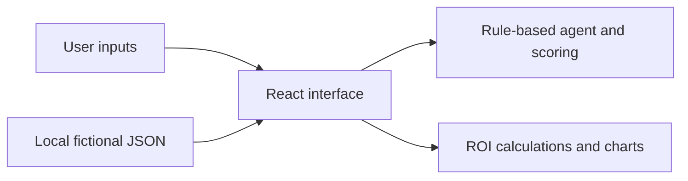

# AI Workforce Opportunity Lab

**From AI opportunity discovery to measurable business impact**

An independent portfolio demonstration by Anushri Rajurkar for a Microsoft AI Workforce Digital Solution Specialist application. The customer, documents, prices and financial assumptions are fictional. This is not a Microsoft product or live Copilot Studio integration.

## Why I built it

AI investment decisions need more than a product demonstration. This lab shows how I would connect a business problem to discovery, solution fit, a measurable pilot and a responsible expansion decision. It draws on my experience designing AI pilots, building ROI-led cases, using adoption analytics and coordinating technical delivery.

## The customer problem and solution strategy

Northstar Advisory is a fictional UK professional-services firm with 500 employees and a 100-user pilot. Fragmented knowledge, manual administration and slow customer responses create an opportunity to test productivity and service improvements. The lab compares in-context Microsoft 365 Copilot use cases with tailored Copilot Studio agent workflows, while recognising that other tools or ordinary automation may be a better fit. A real proposal needs licensing, security and technical validation.

## Explore the demonstration

1. **Overview**: review the executive case and customer story.
2. **Discovery**: change inputs to rank six use cases and inspect the scoring rules.
3. **Simulated agent**: ask sample questions against three fictional documents or try an unsupported question. It is deterministic keyword matching, not a language model or retrieval system; always review source text and responses.
4. **Value calculator**: change assumptions and compare scenarios. Capacity value is not guaranteed cash savings.
5. **90-day roadmap**: examine owners, measures and decision gates.
6. **Account strategy**: explore qualification, objections, partner roles, fit and risks.
7. **Readiness**: score six equally weighted factors. This is not an academically validated instrument.

## Technical architecture



A potential production design could use Copilot Studio with approved permission-aware knowledge, Power Automate for controlled actions, and human review. Validate access controls, identity, governance, licensing and source quality first. This prototype does not implement those services.

## Run locally

Requires Node 20 or newer.

```bash
npm ci
npm run dev
npm run build
npm run preview
```

No API keys, backend or secrets are required. Mock data lives in `src/data.json`. React, TypeScript, Vite, Tailwind CSS, Recharts and Lucide are used.

## Publish to GitHub Pages

1. Create a public GitHub repository named exactly `ai-workforce-opportunity-lab`.
2. From the project directory run:

```bash
git init
git add .
git commit -m "Build AI Workforce Opportunity Lab"
git branch -M main
git remote add origin https://github.com/YOUR_USERNAME/ai-workforce-opportunity-lab.git
git push -u origin main
```

3. In GitHub repository **Settings → Pages → Build and deployment**, select **GitHub Actions**. If the first workflow ran before this setting was selected, rerun it from **Actions → Deploy to GitHub Pages**.
4. Wait for the deployment job to succeed, then open `https://YOUR_USERNAME.github.io/ai-workforce-opportunity-lab/` and verify the application. Vite uses this repository base when `GITHUB_ACTIONS` is set; local preview and Sites use `/`.

## ROI methodology and limitations

Gross hours = licensed users × minutes saved ÷ 60 × working days × adoption. Effective hours = gross hours × realisation. Capacity value = effective hours × loaded hourly cost. Technology cost = users × monthly illustrative licence cost × 12. First-year cost includes technology, implementation and training. Net = capacity value − first-year cost; ROI = net ÷ first-year cost. Payback = upfront cost ÷ (monthly capacity value − monthly technology cost), when positive. All assumptions are editable; additional costs, taxes, benefits, displacement and actual cash savings require customer-specific validation. Scenarios adjust minutes, adoption and realisation; inspect the model for multipliers. The model is not a price quote or prediction.

## About Anushri

Anushri Rajurkar combines customer-facing AI pilot and commercial experience with technical discovery, workflow automation and analytics. Her MSc research explored AI product adoption. The project is an illustrative approach, not evidence that she deployed Microsoft Copilot products.

[LinkedIn](https://www.linkedin.com/in/anushri-r-3812a4156/) · [GitHub](https://github.com/anushri-22)
